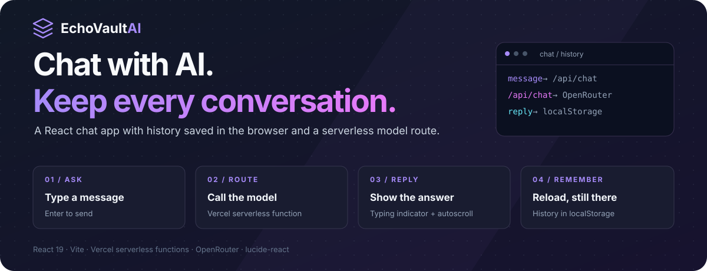
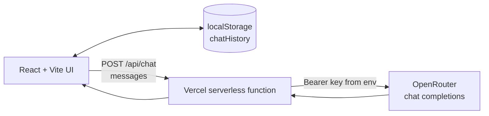

<p align="center">
  
</p>

<p align="center">
  <strong>An AI chat app that remembers your conversation.</strong><br />
  A fast React interface, history saved in your browser, and a serverless route that keeps the API key off the client.
</p>

<p align="center">
  <a href="https://ai-chat-app-saved-history.vercel.app/"></a>
</p>

<p align="center">
  
  
  
  
</p>

<p align="center">
  <a href="#the-product">Product</a> ·
  <a href="#engineering-decisions">Engineering</a> ·
  <a href="#architecture">Architecture</a> ·
  <a href="#run-locally">Run locally</a> ·
  <a href="#creator">Creator</a>
</p>

---

## The product

Plenty of chat demos forget everything on refresh, or ship the model key inside the JavaScript bundle where anyone can copy it.

**EchoVault AI keeps the conversation and protects the key.** Messages persist in the browser between visits, the full history is sent with each request so the model keeps context, and the model call happens in a serverless function, never in the client.

| Capability | What you can do |
| :--- | :--- |
| **AI chat** | Send a message and get a model reply in a clean chat interface. |
| **Saved history** | Conversations are stored in `localStorage` and restored when you reload or come back. |
| **Context-aware replies** | The whole conversation is sent with each message, so follow-up questions work. |
| **Server-side key** | The browser calls `/api/chat`; only the serverless function holds the provider key. |
| **Smooth UX** | Enter to send, Shift+Enter for a new line, a typing indicator and automatic scrolling. |
| **Readable errors** | Provider or network failures appear as a chat message instead of a blank screen. |

### A workflow you can follow

**Type → POST /api/chat with history → OpenRouter → reply rendered → history saved**

## Engineering decisions

| Engineering problem | Implementation | Inspect the code |
| :--- | :--- | :--- |
| API keys must never reach the browser | A Vercel serverless function proxies the request and reads the key from the environment. | [`api/chat.js`](api/chat.js) |
| History should survive a refresh without a database | State initializes from `localStorage` and is written back on every change. | [`src/App.jsx`](src/App.jsx) |
| The model needs context, the UI needs its own message shape | UI messages (`user` / `ai`) are mapped to provider roles (`user` / `assistant`) when sending. | [`src/App.jsx`](src/App.jsx) |
| Upstream errors come in different shapes | Error bodies are normalized into one readable message shown in the chat. | [`src/App.jsx`](src/App.jsx), [`api/chat.js`](api/chat.js) |
| A single-page app needs both static routes and an API | `vercel.json` routes `/api/*` to functions and everything else to `index.html`. | [`vercel.json`](vercel.json) |

## Architecture



| Layer | Technology |
| :--- | :--- |
| Frontend | React 19, Vite 8, lucide-react icons, CSS |
| API | Vercel serverless function (`api/chat.js`) |
| Model | OpenRouter chat completions (`gpt-4o-mini`) |
| Storage | Browser `localStorage` |
| Hosting | Vercel |

<details>
<summary><strong>Scope and known limitations</strong></summary>

- History lives in one browser on one device; clearing site data removes it, and it does not sync across devices.
- There is a single conversation thread, with no way to start, name or delete separate chats yet.
- The full history is sent each time, so very long conversations cost more tokens and can exceed the model's context.
- The `convex/` folder and the empty `server.js` / `index.js` files are leftovers and are not used by the app.

</details>

## Run locally

```bash
git clone https://github.com/Lingu17/ai-chat-app-saved-history.git
cd ai-chat-app-saved-history
npm install
```

Create `.env.local` in the project root with your **OpenRouter** API key (the variable keeps the name `OPENAI_API_KEY`):

```env
OPENAI_API_KEY=your_openrouter_key_here
```

Run the frontend and the serverless function together with the Vercel CLI:

```bash
npx vercel dev
```

`npm run dev` starts only the Vite frontend, so `/api/chat` will not be available that way.

| Script | Purpose |
| :--- | :--- |
| `npm run dev` | Vite dev server (frontend only) |
| `npm run build` | Production build |
| `npm run preview` | Preview the production build |
| `npm run lint` | ESLint |

**Deploy:** import the repository into Vercel and set `OPENAI_API_KEY` (your OpenRouter key) in the project's environment variables.

## Project map

```text
ai-chat-app-saved-history/
├── api/chat.js        Serverless proxy to OpenRouter
├── src/
│   ├── App.jsx        Chat UI, history persistence, request handling
│   ├── index.css      Styles
│   └── main.jsx       React entry
├── public/            Favicon and icons
├── index.html         Vite entry page
├── vercel.json        API and SPA rewrites
└── vite.config.js     Vite configuration
```

## Creator

**Lingraj Malipatil** · [GitHub @Lingu17](https://github.com/Lingu17) · [LinkedIn](https://www.linkedin.com/in/lingraj-malipatil-a2735a241/)

---

<p align="center"><strong>EchoVault AI</strong><br />Chat with AI. Keep every conversation.</p>
